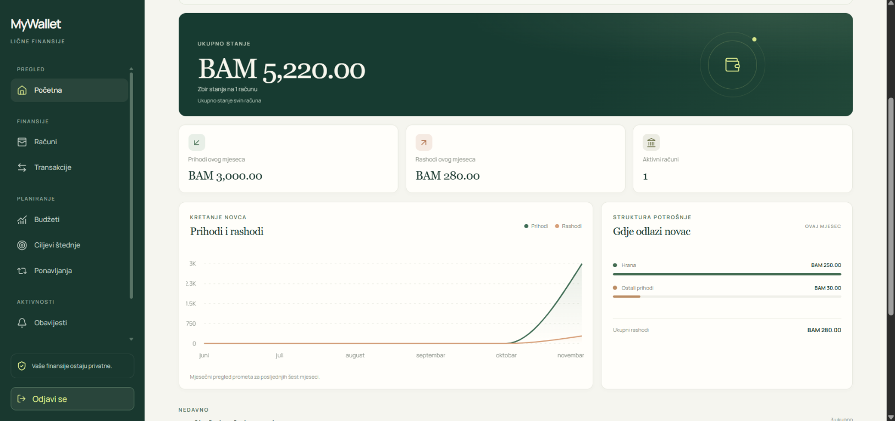
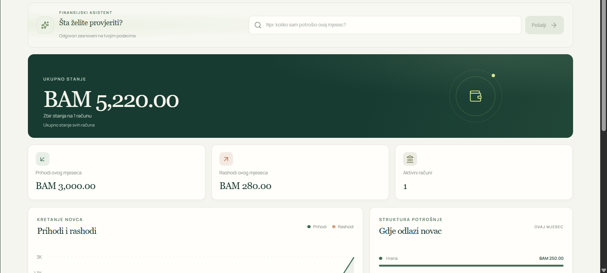
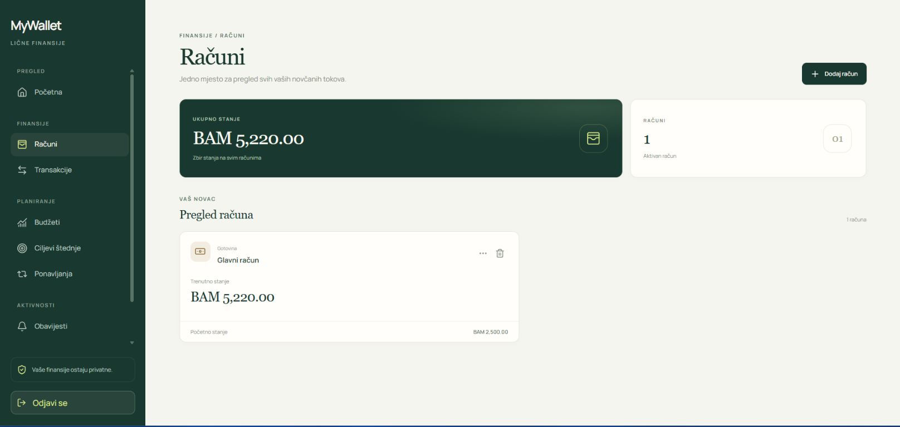
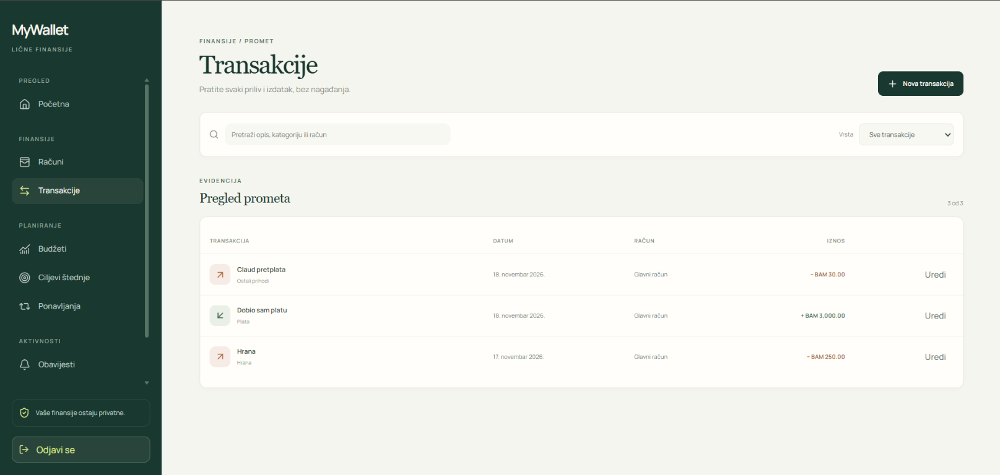
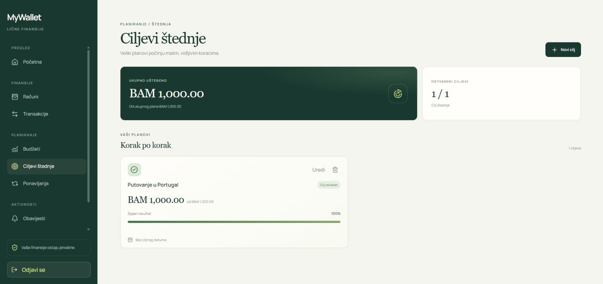
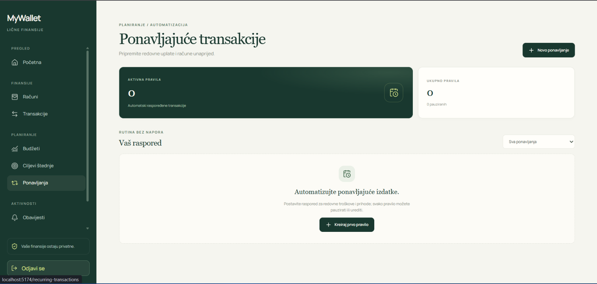
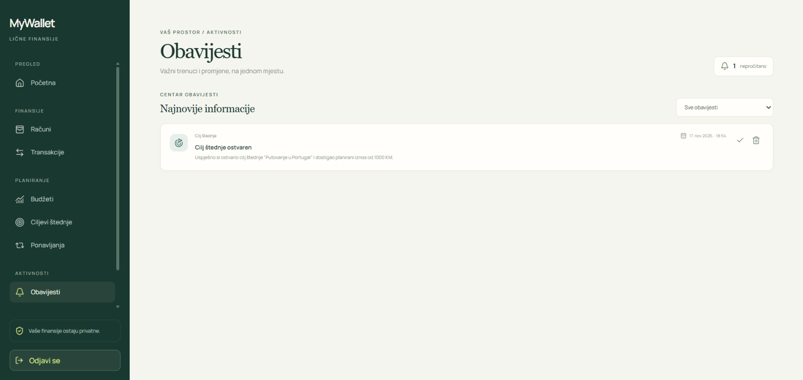
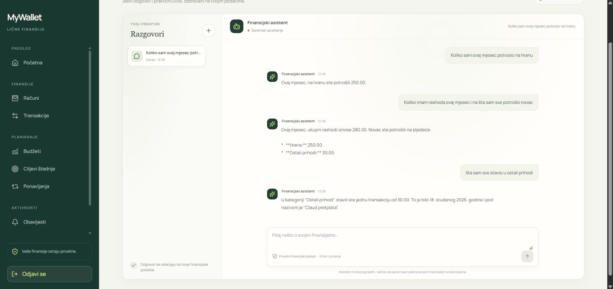
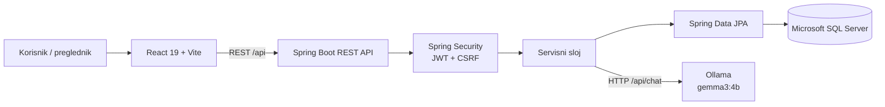
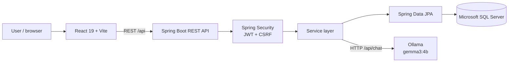

# MyWallet — Personal Finance Manager

MyWallet is a web application for managing personal finances. It brings accounts, transactions, budgets, savings goals, recurring transactions and notifications together with an AI assistant that can answer questions using the signed-in user's financial data.

This README is available in **Bosnian** and **English**.

- [Bosanski](#bosanski)
- [English](#english)

---

## Bosanski

### O projektu

MyWallet pomaže korisniku da prati svoje finansije na jednom mjestu. Prijavljeni korisnik može evidentirati račune i transakcije, planirati mjesečne budžete i ciljeve štednje, pratiti ponavljajuće transakcije i obavijesti te koristiti AI asistenta za pitanja o finansijama.

### Funkcionalnosti

- Pregled stanja računa, mjesečnih prihoda i rashoda, trendova i nedavnih aktivnosti
- Upravljanje računima, kategorijama i transakcijama
- Mjesečni budžeti po kategorijama
- Ciljevi štednje i praćenje napretka
- Ponavljajuće transakcije i obavijesti
- AI razgovori koji se čuvaju za kasniji pregled
- Finansijski kontekst AI odgovora ograničen je na trenutno pitanje i podatke prijavljenog korisnika; raniji odgovori se ne šalju modelu kao historija prompta
- Profil korisnika, promjena lozinke i autentifikacija
- Korisnički interfejs na bosanskom jeziku

### Snimci aplikacije

Snimci prikazuju demo podatke koje je korisnik potvrdio kao sintetičke.

| Pregled | Snimak |
|---|---|
| Početna stranica |  |
| Početna stranica — aktivnosti |  |
| Računi |  |
| Transakcije |  |
| Budžeti |  |
| Ciljevi štednje |  |
| Ponavljajuće transakcije |  |
| Obavijesti |  |
| AI asistent |  |

### Arhitektura

Projekat je organizovan kao React klijentska aplikacija i Spring Boot REST backend. Backend pristupa SQL Serveru preko Spring Data JPA, a AI servis šalje zahtjev lokalnoj Ollama instanci.



- **Frontend:** React 19, React Router, Vite 8 i Tailwind CSS. Stranice su organizovane u `frontend/src/pages`, API pozivi u `frontend/src/services`, a autentifikacija u kontekstu i hookovima.
- **Backend:** Java 25 i Spring Boot 4. Kontroleri izlažu REST rute; servisi provode poslovnu logiku, a repozitoriji pristupaju podacima putem JPA.
- **Baza:** Microsoft SQL Server. Entiteti opisuju mapiranje na postojeće tabele; Hibernate automatsko kreiranje i izmjena šeme su isključeni.
- **AI:** Backend gradi prompt od sistemskih instrukcija, trenutnog pitanja i relevantnog finansijskog konteksta te komunicira s Ollamom preko njenog HTTP API-ja.
- **Lokalni razvoj:** Vite na portu `5174` prosljeđuje `/api` zahtjeve backendu na portu `8080`.

### Baza podataka

Aplikacija koristi SQL Server bazu `AIFinanceDB`. Ispod je pregled tabela mapiranih JPA entitetima i njihovih glavnih veza. Entiteti su mapirani na `dbo` osim entiteta `User`, koji ne navodi šemu eksplicitno.

| Tabela | Namjena | Glavne veze |
|---|---|---|
| `users` | Korisnički profil i hash lozinke | Korisnik je vlasnik računa, transakcija, budžeta, ciljeva štednje, kategorija, obavijesti, razgovora i refresh tokena |
| `accounts` | Finansijski računi i početno stanje | Pripada korisniku; koristi se u transakcijama i ponavljajućim transakcijama |
| `categories` | Kategorije prihoda i rashoda | Može biti korisnička ili zajednička kategorija; koristi se u transakcijama, budžetima i ponavljajućim transakcijama |
| `transactions` | Evidencija prihoda i rashoda | Povezuje korisnika, kategoriju i račun; može sadržavati referencu na ponavljajuće pravilo |
| `budgets` | Ograničenja potrošnje po mjesecu, godini i kategoriji | Pripada korisniku i kategoriji |
| `saving_goals` | Ciljni i trenutno ušteđeni iznos, naziv i ciljni datum | Pripada korisniku |
| `recurring_transactions` | Pravila za periodično evidentiranje transakcija | Povezuje korisnika, kategoriju i račun |
| `notifications` | Poruke i status pročitanosti | Pripada korisniku |
| `ai_conversations` | Naslov i metapodaci AI razgovora | Pripada korisniku |
| `ai_messages` | Poruke i odgovori u razgovoru | Pripada AI razgovoru |
| `refresh_token` | Hash, rok važenja i opoziv refresh tokena | Pripada korisniku |

Repozitorij trenutno **ne sadrži SQL DDL, migracije ni skriptu za inicijalno kreiranje baze**. `spring.jpa.hibernate.ddl-auto=none` znači da baza i potrebne tabele moraju već postojati prije pokretanja aplikacije.

### REST API

Osnovne rute backend kontrolera:

| Resurs | Ruta |
|---|---|
| Autentifikacija i profil | `/api/auth` — CSRF token, registracija, prijava, obnova tokena, odjava, profil i promjena lozinke |
| Zdravlje servisa | `GET /api/health` |
| Računi | `/api/accounts` |
| Kategorije | `/api/categories` |
| Transakcije | `/api/transactions` |
| Budžeti | `/api/budgets` |
| Ciljevi štednje | `/api/saving-goals` |
| Ponavljajuće transakcije | `/api/recurring-transactions` |
| Obavijesti | `/api/notifications` |
| AI razgovori i poruke | `/api/ai/conversations` |
| AI finansijski podaci | `/api/ai/financial` |

Većina finansijskih ruta zahtijeva autentifikovanog korisnika. Backend provjerava vlasništvo nad razgovorima i finansijskim podacima kako bi zahtjev bio ograničen na prijavljenog korisnika.

### AI i MCP integracija

AI asistent koristi **Ollamu**, podrazumijevano s modelom `gemma3:4b`. Backend šalje HTTP zahtjev na Ollama `/api/chat` endpoint. Za pitanja koja se odnose na konkretne finansijske podatke backend prvo priprema kontekst iz baze za prijavljenog korisnika; direktni odgovori o napretku cilja štednje mogu se izračunati u backendu.

**MCP trenutno nije implementiran u ovom repozitoriju.** Nema MCP klijenta niti MCP servera u aplikacijskom kodu; komunikacija s modelom ide direktno preko Ollama HTTP API-ja. Zbog toga se MCP ne predstavlja kao postojeća integracija.

### Sigurnost i autentifikacija

- Spring Security štiti API i koristi stateless autentifikaciju JWT pristupnim tokenom.
- Podrazumijevano trajanje pristupnog tokena je 10 minuta; može se promijeniti varijablom `JWT_EXPIRATION_MINUTES`.
- Refresh token se šalje u `HttpOnly`, `SameSite=Strict` kolačiću, važi 7 dana i u bazi se čuva njegov SHA-256 hash.
- CSRF zaštita je uključena.
- Lozinke se obrađuju pomoću BCrypt hashiranja.
- Tajne i lozinke za produkciju ne treba unositi u README, izvorni kod niti Git.
- Za HTTPS produkciju postaviti `app.auth.cookie.secure=true`.

### Tehnologije i preduslovi

| Dio | Tehnologije |
|---|---|
| Frontend | React 19, Vite 8, React Router, Tailwind CSS, Recharts |
| Backend | Java 25, Spring Boot 4, Spring Security, Spring Data JPA, Bean Validation |
| Baza podataka | Microsoft SQL Server |
| AI servis | Ollama (`gemma3:4b` podrazumijevano) |

Za lokalno pokretanje potrebno je:

- JDK 25
- Node.js 22.12 ili noviji i npm
- SQL Server s bazom `AIFinanceDB` i unaprijed kreiranim tabelama
- Ollama i model `gemma3:4b`

Preuzmi model jednom:

```powershell
ollama pull gemma3:4b
```

### Konfiguracija i pokretanje

Backend čita tajne iz varijabli okruženja. Postavi ih u istom PowerShell prozoru u kojem pokrećeš backend:

```powershell
$env:DB_PASSWORD = '<lozinka SQL Server login-a aifinance_app>'
$env:JWT_SECRET = '<Base64 tajna sa najmanje 32 nasumična bajta>'
$env:JWT_EXPIRATION_MINUTES = '10'
```

`JWT_EXPIRATION_MINUTES` nije obavezna; podrazumijevana vrijednost je `10`. SQL Server je podrazumijevano na `localhost:1433`, baza je `AIFinanceDB`, a Ollama na `http://localhost:11434`. Vrijednosti se mogu prilagoditi u [`application.properties`](backend/src/main/resources/application.properties).

Pokreni backend:

```powershell
cd backend
.\mvnw.cmd spring-boot:run
```

Pokreni frontend u drugom terminalu:

```powershell
cd frontend
npm ci
npm run dev
```

Otvori adresu koju Vite ispiše — podrazumijevano `http://localhost:5174`. Backend je dostupan na `http://localhost:8080`, a provjera zdravlja na `http://localhost:8080/api/health`.

### Provjere

U direktoriju `frontend`:

```powershell
npm run lint
npm run build
```

U direktoriju `backend`:

```powershell
.\mvnw.cmd test
```

Backend testovi koji podižu Spring kontekst zahtijevaju dostupnu i ispravno konfigurisanu SQL Server bazu.

### Struktura repozitorija

```text
backend/
  src/main/java/com/aifinance/backend/
    config/       sigurnosna i servisna konfiguracija
    controller/   REST kontroleri
    dto/          objekti zahtjeva i odgovora
    entity/       JPA mapiranja SQL tabela
    repository/   Spring Data repozitoriji
    service/      poslovna logika, autentifikacija i AI integracija
  src/main/resources/
    application.properties
frontend/
  src/
    components/   ponovo upotrebljive UI komponente
    context/      stanje aplikacije
    hooks/        React hookovi
    layouts/      rasporedi stranica
    pages/        stranice aplikacije
    services/     pozivi prema backend API-ju
docs/
  screenshots/    demo snimci ekrana
```

### Licenca

U repozitoriju trenutno nema licence. Dodaj licencu prije objave ako želiš jasno definisati uslove korištenja, izmjene i distribucije projekta.

---

## English

### About

MyWallet is a web application for tracking personal finances in one place. Signed-in users can manage accounts and transactions, plan monthly budgets and savings goals, track recurring transactions and notifications, and ask an AI assistant questions about their finances.

### Features

- Dashboard with account balances, monthly income and expenses, trends, and recent activity
- Account, category, and transaction management
- Monthly budgets by category
- Savings goals and progress tracking
- Recurring transactions and notifications
- AI conversations saved for later review
- AI requests use the current question and the signed-in user's relevant financial data; previous answers are not sent to the model as prompt history
- User profile, password change, and authentication
- Bosnian-language user interface

### Application screenshots

The screenshots show demo data confirmed by the user to be synthetic. See the [gallery above](#snimci-aplikacije).

### Architecture

The project consists of a React client and a Spring Boot REST backend. The backend accesses SQL Server through Spring Data JPA and sends AI requests to a local Ollama instance.



- **Frontend:** React 19, React Router, Vite 8, and Tailwind CSS. Pages live in `frontend/src/pages`, API calls in `frontend/src/services`, and authentication state in the app context and hooks.
- **Backend:** Java 25 and Spring Boot 4. Controllers expose REST routes, services implement business logic, and repositories access data through JPA.
- **Database:** Microsoft SQL Server. JPA entities map the existing tables; Hibernate schema creation and updates are disabled.
- **AI:** The backend builds a prompt from system instructions, the current question, and relevant financial context, then communicates with Ollama over its HTTP API.
- **Local development:** Vite runs on port `5174` and proxies `/api` requests to the backend on port `8080`.

### Database

The application uses the `AIFinanceDB` SQL Server database. The table list below is based on the JPA entity mappings and their primary relationships. Entities are mapped to `dbo` except for `User`, which does not explicitly specify a schema.

| Table | Purpose | Main relationships |
|---|---|---|
| `users` | User profile and password hash | Owns accounts, transactions, budgets, savings goals, categories, notifications, conversations, and refresh tokens |
| `accounts` | Financial accounts and opening balances | Belongs to a user; referenced by transactions and recurring transactions |
| `categories` | Income and expense categories | May be user-specific or shared; referenced by transactions, budgets, and recurring transactions |
| `transactions` | Income and expense records | References a user, category, and account; may include a recurring-rule reference |
| `budgets` | Spending limits by month, year, and category | Belongs to a user and a category |
| `saving_goals` | Goal name, target/current amount, and target date | Belongs to a user |
| `recurring_transactions` | Rules for periodic transactions | References a user, category, and account |
| `notifications` | Messages and read state | Belongs to a user |
| `ai_conversations` | AI conversation title and metadata | Belongs to a user |
| `ai_messages` | Conversation messages and responses | Belongs to an AI conversation |
| `refresh_token` | Refresh-token hash, expiry, and revocation | Belongs to a user |

The repository currently **does not include SQL DDL, migrations, or a database initialization script**. Because `spring.jpa.hibernate.ddl-auto=none`, the database and required tables must exist before the application starts.

### REST API

Main backend controller routes:

| Resource | Route |
|---|---|
| Authentication and profile | `/api/auth` — CSRF token, registration, login, refresh, logout, profile, and password change |
| Service health | `GET /api/health` |
| Accounts | `/api/accounts` |
| Categories | `/api/categories` |
| Transactions | `/api/transactions` |
| Budgets | `/api/budgets` |
| Savings goals | `/api/saving-goals` |
| Recurring transactions | `/api/recurring-transactions` |
| Notifications | `/api/notifications` |
| AI conversations and messages | `/api/ai/conversations` |
| AI financial data | `/api/ai/financial` |

Most financial routes require an authenticated user. The backend checks ownership of conversations and financial data so requests are scoped to the signed-in user.

### AI and MCP integration

The AI assistant uses **Ollama**, with `gemma3:4b` as the default model. The backend sends HTTP requests to Ollama's `/api/chat` endpoint. For financial questions, the backend first builds context from the signed-in user's database records. Direct questions about savings-goal progress can be answered by calculations in the backend.

**MCP is not currently implemented in this repository.** There is no MCP client or MCP server in the application code; model communication goes directly through Ollama's HTTP API. The README therefore does not present MCP as an existing integration.

### Security and authentication

- Spring Security protects the API and uses stateless JWT access-token authentication.
- Access tokens expire after 10 minutes by default; configure `JWT_EXPIRATION_MINUTES` to change this.
- Refresh tokens are sent in an `HttpOnly`, `SameSite=Strict` cookie, expire after 7 days, and are stored in the database as SHA-256 hashes.
- CSRF protection is enabled.
- Passwords are hashed with BCrypt.
- Do not put production credentials or secrets in this README, source files, or Git.
- Set `app.auth.cookie.secure=true` when deploying over HTTPS.

### Technology stack and prerequisites

| Area | Technologies |
|---|---|
| Frontend | React 19, Vite 8, React Router, Tailwind CSS, Recharts |
| Backend | Java 25, Spring Boot 4, Spring Security, Spring Data JPA, Bean Validation |
| Database | Microsoft SQL Server |
| AI service | Ollama (`gemma3:4b` by default) |

To run locally, install:

- JDK 25
- Node.js 22.12 or newer and npm
- SQL Server with the `AIFinanceDB` database and required tables already created
- Ollama and the `gemma3:4b` model

Pull the model once:

```powershell
ollama pull gemma3:4b
```

### Configuration and local setup

The backend reads secrets from environment variables. Set them in the same PowerShell window used to start the backend:

```powershell
$env:DB_PASSWORD = '<password for the aifinance_app SQL Server login>'
$env:JWT_SECRET = '<Base64 secret containing at least 32 random bytes>'
$env:JWT_EXPIRATION_MINUTES = '10'
```

`JWT_EXPIRATION_MINUTES` is optional and defaults to `10`. SQL Server defaults to `localhost:1433` with database `AIFinanceDB`; Ollama defaults to `http://localhost:11434`. Configure these values in [`application.properties`](backend/src/main/resources/application.properties).

Start the backend:

```powershell
cd backend
.\mvnw.cmd spring-boot:run
```

Start the frontend in a second terminal:

```powershell
cd frontend
npm ci
npm run dev
```

Open the address printed by Vite — `http://localhost:5174` by default. The backend listens on `http://localhost:8080`; its health endpoint is `http://localhost:8080/api/health`.

### Checks

From `frontend`:

```powershell
npm run lint
npm run build
```

From `backend`:

```powershell
.\mvnw.cmd test
```

Backend tests that start the Spring application context require a reachable and correctly configured SQL Server database.

### Repository structure

```text
backend/
  src/main/java/com/aifinance/backend/
    config/       security and service configuration
    controller/   REST controllers
    dto/          request and response objects
    entity/       SQL table mappings
    repository/   Spring Data repositories
    service/      business logic, authentication, and AI integration
  src/main/resources/
    application.properties
frontend/
  src/
    components/   reusable UI components
    context/      application state
    hooks/        React hooks
    layouts/      page layouts
    pages/        application pages
    services/     backend API calls
docs/
  screenshots/    demo screenshots
```

### License

There is currently no license file in the repository. Add a license before publishing if you want to specify how others may use, modify, or distribute the project.
